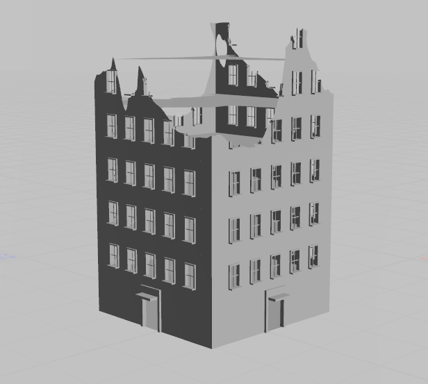

The focus of this milestone was on making a basic shape for a building and to experiment with making the building “run down.”

Currently, the buildings are made using the _Labs Building from Pattern_ node, which provides a quick way to create a simple building by specifying a pattern of smaller models (e.g. for windows and doors) for each floor and by further specifying a pattern of floors, resulting in a building with different floor designs. Main drawback of this node is that it only works for the exterior of the building, with no explicit way to add interior (such as walls between rooms). Another drawback is the each side of the building follows the same pattern, which is why there are doors on each side of the building.

Window and door models were made in Blender and imported in Houdini using the _File_ node.

The “run down” effect was accomplished by scattering (_Scatter_ node) randomly scaled spheres on top of the building and then subtracting them from the building shape using the _Boolean_ node. There are actually two sets of spheres that were scattered: a bunch of smaller spheres scattered all over the roof, and another set scattered around the rim of the roof. The spheres in the latter set are taller so more damage is dealt to the outer walls instead of the floors/ceilings of the upper levels. Because the spheres are smooth by default, noise was added to their vertex positions (_Attribute Noise_ node) to make them rougher, therefore making the ruins more realistic.
